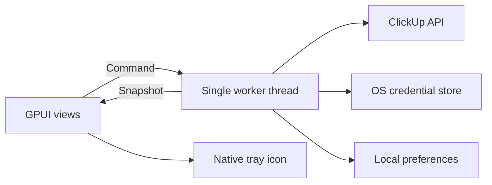

# Architecture

ClickUp Tray Time Tracker is a native Rust desktop client built with GPUI Kit and gpui-tray. It uses a personal API token and talks directly to ClickUp. The same source targets macOS and Windows; desktop Linux is not currently packaged.

## Modules

| Module | Responsibility |
| --- | --- |
| `main.rs` | App lifetime, single-instance lock, tray, popup, worker event delivery |
| `ui.rs` | Task picker, creation form, settings, language/workspace/list selection |
| `summary_ui.rs` | Summary cards, progress bars, editable goals |
| `worker.rs` | Serialized commands, snapshots, synchronization, account state |
| `api.rs` | ClickUp HTTP contracts, timeouts, validation, timer verification |
| `model.rs` | API data models, task-link validation, elapsed time formatting |
| `summary.rs` | Calendar periods, entry merging, goal calculations |
| `locale.rs` | Typed English/Czech catalogs, structured messages and interpolation |
| `storage.rs` | Local preferences and OS credential-store access |

## Data flow

The UI sends a command and disables conflicting actions until the worker reports completion. Periodic snapshots do not complete a pending command. Network requests and credential-store prompts never run on the UI thread.

Closing the popup releases its view and repaint task. The tray and worker remain alive. Quitting the application deliberately leaves the server-side timer unchanged.

## Timer mutations

1. Read the running entry before changing tracking.
2. If the requested task is already running, return it without restarting it.
3. Verify the destination task's access and workspace before stopping an existing timer.
4. Stop the old timer, then start the destination task.
5. Confirm the requested running task through `/current`; mutation response bodies are not assumed to match read responses.

A lost response does not imply a failed write. The app reconciles state without replaying the mutation. Failed stops prevent a subsequent start. Task creation is never automatically retried, and a successfully created task is kept available if starting tracking fails.

## Summaries

Period boundaries use the system local calendar: first day of the month and Monday of the current week. Entries are clipped to period boundaries. Running entries are merged by ID, newer completed history supersedes stale current state, and an older running entry is capped at the next timer's start.

History and current-state verification are independent. Completed history remains useful when the current endpoint is unavailable. An unverified running entry is not extrapolated into new worked hours. Goals are local, per-workspace preferences; they do not modify ClickUp workspace settings.

## Localization

English is the default. The persisted language is carried in worker snapshots and applied to app text, errors, tray status, and the framework controls used by the UI. Settings are available before connecting an account. User content is never translated.

`Message` preserves typed keys and arguments through error contexts. Translation happens when rendering, so changing language also changes already-visible app-owned errors. Locale tests cover defaults, persistence compatibility, catalog coverage, and safe interpolation.

## Storage and compatibility

The credential service and application data directory keep stable names to preserve existing installations. Tokens are stored only in Keychain/Credential Manager. JSON preferences store language, workspace, recent tasks, last list, and goals. Missing newer fields have defaults for compatibility.

Preferences are replaced through a temporary file and an atomic rename. An OS file lock prevents two local instances from updating the same settings. Tests inject failure boundaries and use local HTTP fixtures; they do not access a user's credential store or live workspace.
